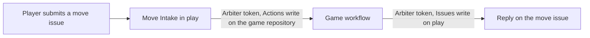

<!--
title: '🤖 GITHUB APP'
description: 'How the Official Arbiter, the GitHub App behind the games, is set up, what it is allowed to do, and how its private key is stored and rotated.'
tags: [github-app, permissions, secrets, setup]
category: docs
-->

<!-- markdownlint-disable MD041 -->
<div align="center">

# 🤖 GITHUB APP

<a name="top"></a>

**The Official Arbiter: the one credential that carries a move to its game.**

_Set up once, by the owner. Never by a player._

</div>

---

## 💡 What It Is

Every move arrives here as an issue, but the game it is for lives in another
repository. Crossing between the two takes a credential, and this repository
uses a GitHub App for it: the **Official Arbiter**, owned by @tannergolden and
installed on this repository and on every game's. It takes its name from chess,
where the arbiter is the official who rules on moves, and that is its job here:
it hands each move to its game, and posts the game's ruling on the move's issue.

An App rather than a personal access token, because every run asks it for a
fresh token that:

- **lives an hour at most**, and is revoked as soon as the job ends;
- **reaches only the repository it is for**, with only the permission that
  run needs;
- **belongs to no person**, so nothing breaks when a token expires or a
  password changes, and everything it posts appears as the bot.

> [!NOTE]
> **Players never touch it.** A player needs nothing but a GitHub account:
> there is nothing to install, nothing to authorize, and no token of their
> own. The owner sets the App up once, and it serves every game.



---

## 🛡️ What It May Do

| Permission   | Access         | Needed on              | Used by        | For                                                 |
| :----------- | :------------- | :--------------------- | :------------- | :-------------------------------------------------- |
| **Actions**  | Read and write | Each game's repository | 🎲 Move Intake | Starting the game's workflow                        |
| **Issues**   | Read and write | This repository        | Each game      | Its replies on a move's issue, and its turn notices |
| **Metadata** | Read-only      | Both                   | -              | Granted to every App                                |

**Nothing else.** No contents, no pull requests, no organization or account
permissions, no webhook, and no events. A permission an App holds applies on
every repository it is installed on, so each run narrows its own token
further: the intake asks for Actions write on the one game's repository, and
a game asks for Issues write on this one.

---

## 🚀 Setting It Up

About ten minutes, all in the browser, done once by the owner.

### 1. Register The App

- [ ] Open [github.com/settings/apps/new](https://github.com/settings/apps/new), or go to **Settings → Developer settings → GitHub Apps** and click <kbd>New GitHub App</kbd>.
- [ ] Fill it in as below, then click <kbd>Create GitHub App</kbd>.

| Field                                                      | Set it to                                                                                    |
| :--------------------------------------------------------- | :------------------------------------------------------------------------------------------- |
| **GitHub App name**                                        | `Official Arbiter`, which players see as `official-arbiter[bot]`                             |
| **Description**                                            | The text below, word for word                                                                |
| **Homepage URL**                                           | `https://github.com/tannergolden/play`                                                       |
| **Callback URL**                                           | Empty                                                                                        |
| **Expire user authorization tokens**                       | Leave it as it is: no player ever signs in, so it never applies                              |
| **Request user authorization (OAuth) during installation** | Unchecked                                                                                    |
| **Enable Device Flow**                                     | Unchecked                                                                                    |
| **Setup URL**, **Redirect on update**                      | Empty, and unchecked                                                                         |
| **Webhook → Active**                                       | **Unchecked.** Then no webhook URL or secret is needed                                       |
| **Repository permissions**                                 | **Actions:** Read and write. **Issues:** Read and write. Metadata turns Read-only on its own |
| **Organization and account permissions**                   | No access                                                                                    |
| **Subscribe to events**                                    | Nothing                                                                                      |
| **Where can this GitHub App be installed?**                | **Only on this account**                                                                     |

The description:

```text
Arbiter rules on the games played on the @tannergolden profile README.

Every move on the profile is a link that opens a ready-made issue in tannergolden/play. When one is submitted, the Arbiter starts that game's workflow, which checks the move, plays it and redraws the board. It then answers on the move's issue: the move is on the board, or why it could not be played, and whose turn it is now. When it is @tannergolden's turn, it says so with a mention.

Beyond the read-only metadata every app has, it holds two permissions and nothing more: running workflows in each game's repository, and writing issues and comments in tannergolden/play. It cannot read or change code, open pull requests, or touch any other repository. Every run gets a token that lasts an hour at most, reaches a single repository, and is revoked when the run ends.

Players never install or authorize the Arbiter. A GitHub account and a click on a move is all it takes to play.
```

> [!TIP]
> **"Webhook URL is required"** means the **Active** box under **Webhook** is
> still ticked, as it is by default. Untick it and the field stops being
> required. The Arbiter never receives webhooks, so the URL and secret stay
> empty.

### 2. Collect Its Credentials

On the App's **General** page:

- [ ] Copy the **Client ID**, which starts with `Iv`. The workflows use it, not the numeric App ID.
- [ ] Under **Private keys**, click <kbd>Generate a private key</kbd>. A file such as `official-arbiter.2026-10-11.private-key.pem` downloads.
- [ ] Optionally, upload a logo under **Display information**. It is the avatar players see beside every reply a game posts.

### 3. Install It

- [ ] In the App's sidebar, click <kbd>Install App</kbd>, then <kbd>Install</kbd> beside `tannergolden`.
- [ ] Choose **Only select repositories**, pick `play` and `tannergolden`, and click <kbd>Install</kbd>.

### 4. Store The Credentials

Both repositories hold the same two values: this one to start a game, and
each game's to reply here.

| Name                   | Kind     | Value                                                                 | Stored in                                        |
| :--------------------- | :------- | :-------------------------------------------------------------------- | :----------------------------------------------- |
| `PLAY_APP_CLIENT_ID`   | Variable | The Client ID                                                         | `tannergolden/play`, `tannergolden/tannergolden` |
| `PLAY_APP_PRIVATE_KEY` | Secret   | The whole `.pem` file, its `-----BEGIN` and `-----END` lines included | `tannergolden/play`, `tannergolden/tannergolden` |

- [ ] In each repository, open **Settings → Secrets and variables → Actions**.
- [ ] On the **Variables** tab, click <kbd>New repository variable</kbd> and add the Client ID.
- [ ] On the **Secrets** tab, click <kbd>New repository secret</kbd> and add the private key.

Or from a terminal, with the GitHub CLI, which reads the key straight from the
file rather than through a paste:

```bash
for repo in tannergolden/play tannergolden/tannergolden; do
  gh variable set PLAY_APP_CLIENT_ID --repo "$repo" --body 'YOUR_CLIENT_ID'
  gh secret set PLAY_APP_PRIVATE_KEY --repo "$repo" < path/to/official-arbiter.private-key.pem
done
```

### 5. Finish

- [ ] Delete the downloaded key, or move it into a password manager. GitHub never shows it again, and a new one can be generated at any time.
- [ ] Set this repository to **Watch → Participating and @mentions**, so a move that fails and a game's notice for you reach you, and nothing else does.

Until both values exist here, every move fails with a reply that @mentions the
owner.

---

## 🤖 What Players See

| Where                               | Shown as                                           |
| :---------------------------------- | :------------------------------------------------- |
| The intake's 🚀, reply and closing  | `github-actions[bot]`, this repository's own token |
| Every reply and notice a game posts | `official-arbiter[bot]`, with the App's logo       |
| An install or authorize prompt      | Never                                              |

The App's name is on show in every reply a game posts, which is why it is the
Official Arbiter: to a player, each ruling comes from the arbiter, as it would
at a board.

---

## ⚙️ Adding A Game

- [ ] Open **Settings → Applications → Installed GitHub Apps**, click <kbd>Configure</kbd> beside **Official Arbiter**, add the game's repository under **Repository access**, and click <kbd>Save</kbd>.
- [ ] Store `PLAY_APP_CLIENT_ID` and `PLAY_APP_PRIVATE_KEY` in the game's repository, as in step 4.
- [ ] Add the game's row to `intake/routes.json`, as [`intake/README.md`](../intake/README.md) describes.

There is no second App, and nothing new to store here.

---

## 🛡️ Keeping The Key Safe

The private key is the only thing that can mint the App's tokens, so it lives
in exactly two kinds of place: this repository's secrets and each game's.

- **It is never committed.** This repository's `.gitignore` already ignores
  `*.pem`, so a key left in the working tree cannot be added by accident.
- **Rotating it leaves no gap.** An App can hold more than one key at once:
  generate a new key, update `PLAY_APP_PRIVATE_KEY` in every repository that
  stores it, then delete the old key on the App's **General** page.
- **A leaked key is rotated at once**, the same way. Deleting the old key is
  what stops it working.
- **A new permission waits for approval.** When the App is given more
  permissions later, the installation has to accept them before they apply,
  from **Settings → Applications → Installed GitHub Apps**.

---

## 🩺 When A Move Fails

A failed move gets a reply on its issue that @mentions the owner, and its run
in the Actions tab names the step that failed.

| Step that failed       | What it says                             | Fix                                                                               |
| :--------------------- | :--------------------------------------- | :-------------------------------------------------------------------------------- |
| 🔑 Mint The Game Token | A client ID or private key is missing    | Store `PLAY_APP_CLIENT_ID` and `PLAY_APP_PRIVATE_KEY` here, as in step 4          |
| 🔑 Mint The Game Token | The private key cannot be read           | Store the whole `.pem` file again, from `-----BEGIN` to `-----END`                |
| 🔑 Mint The Game Token | No installation was found                | Install the App on the game's repository                                          |
| 🎯 Start The Game      | `Resource not accessible by integration` | Give the App Actions write, and accept the change on its installation             |
| 🎯 Start The Game      | `Not Found`                              | The workflow named in `intake/routes.json` does not exist on its `ref`            |
| 🎯 Start The Game      | `No ref found for`                       | The `ref` in `intake/routes.json` names no branch or tag of the game's repository |
| 🎯 Start The Game      | `Unexpected inputs provided`             | The game's workflow has to declare every input it is sent                         |

---

<div align="center">

**One key, held by the owner, opening one door per move.**

[↑ Back to Top](#top)

<br />

Built with ❤️ by the Engineering Team. Distributed under the MIT License.

</div>
