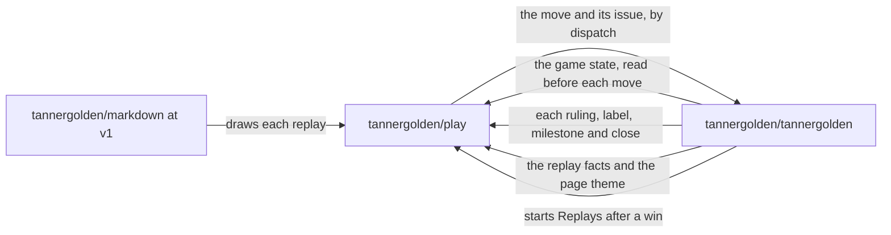

<!--
title: '🤝 CROSS-REPOSITORY CONTRACTS'
description: 'Everything this repository and the ones it works with must keep agreeing on: the dispatch a game receives, the game state the check reads, the replay facts and the theme a replay is drawn from, what a game does here, and the command the kit is run with. Consult it before changing either side of one.'
type: reference
-->

<div align="center">

# 🤝 CROSS-REPOSITORY CONTRACTS

<a name="top"></a>

**What this repository and the two it works with must keep agreeing on.**

_Change both sides, or neither._

</div>

---

## 💡 Why This Page Exists

This repository holds no game. Every move crosses into
[tannergolden/tannergolden](https://github.com/tannergolden/tannergolden), the
state the check reads and the facts every replay is drawn from are written
there, the kit in [tannergolden/markdown](https://github.com/tannergolden/markdown)
draws each replay, and each ruling comes back here from the game. The code on
each side holds only its own half of every agreement below, so a change made
to one side alone either strands moves or quietly weakens a check.



---

## 📨 The Dispatch A Game Receives

- **Where it goes.** The game's row in [`routes.json`](../../src/intake/routes.json)
  names its `repository`, `workflow` and `ref`. 🎲 Move Intake posts to that
  workflow's dispatch, on that `ref`, with a token that can start workflows in
  that one repository and do nothing else there.
- **What it carries.** `{"ref": "<ref>", "inputs": {...}}`: one input for each
  group the row's pattern names, and `issue`, `player` and `player_id`, which
  the intake fills from the issue itself. Every value is a string, one short
  token of letters, digits and `_.+#=-`. The inputs of each game are in the
  intake's [What A Game Receives](../../src/intake/README.md#-what-a-game-receives).
- **What the game's side holds.** A `workflow_dispatch` trigger on that `ref`
  that declares every input it is sent: GitHub refuses a dispatch that carries
  an input the workflow doesn't declare, and the move is `stranded`. As
  [GitHub App](../operations/GitHub-App.md) says, the game also reads every
  move back from its issue before playing it.
- **What the links hold.** Each move link on the profile opens the form by its
  file name, `move.yml`, with the title written to match the row's pattern from
  end to end, the game and the move number stamped into it. A title in any
  other shape is turned away as `invalid`, unless the owner opened it.

---

## 📥 The State The Check Reads

🎲 Move Intake reads `.github/<game>/game.json` from the row's repository, at
the row's `ref`, through the contents API with its own token, before the check
of every new move; an issue sent again skips it. A 404 means no game has
started, and any other failure leaves the state unread. The check then judges
without it: the hour's limit still holds, and in Chess and Checkers, whose
openers never change, a move from the wrong side is still turned away, but
every other move goes on for the game to judge.

| Field     | Holds                                                                             | The check uses it for                                             |
| :-------- | :-------------------------------------------------------------------------------- | :---------------------------------------------------------------- |
| `game`    | The number of the game on the board, from 1                                       | A move for a game that is over, and a move number already played  |
| `moves`   | Every move played, in order, each an object                                       | A move already on the board, and whose turn it is                 |
| `ghosts`  | Pentago and Tic-Tac: the ghosts placed, two at most, before any move              | The same, under the Ghost Rule                                    |
| `started` | When the game opens or opened, such as `2026-10-14T16:00:00Z`                     | A move for the next game while the last one's winning board is up |
| `places`  | Pentago and Tic-Tac: `house` or `github`, the side drawn to place the first ghost | Whose ghost is due                                                |
| `opens`   | Pentago and Tic-Tac: `house` or `github`, the side drawn to move first            | Whose move is due, once both ghosts are down                      |

Each turn in `ghosts` and `moves`:

| Field                                 | Holds                                                       |
| :------------------------------------ | :---------------------------------------------------------- |
| `san` in Chess, `shown` in the others | The turn as the score sheet shows it, such as `e4` or `Xd4` |
| `player`, `player_id`                 | The login and the account ID of whoever played it           |
| `arbiter`                             | `true` when the Arbiter played it                           |

A turn also keeps the move under the name of the input that carried it, `uci`
or `move`, which the check doesn't read.

**A change here fails nothing loudly.** A state not shaped as a game's is
judged as unread, and a turn the check can't name is left to the game, so a
renamed field lets through moves the door would have answered, and the game
turns them away instead. Change `GAMES` and `board()` in
[`check.py`](../../src/intake/check.py) with the game, and its tests with them:
`test_check.py` holds the path the workflow reads against the one the check
expects.

---

## 🎬 The Replay Facts And The Theme

🎬 Replays checks out the profile's default branch, and from it only
`.github/*/games/*.replay.json` and `.github/workflows/markdown.yml`. The game's
engine writes `game-<N>.replay.json` beside each game it records as won by a
person's own move, and starts 🎬 Replays here; the hourly run finds any that
dispatch missed.

What `problem()` in [`build.py`](../../src/replays/build.py) checks before a game is
kept, the kit checking every field it draws:

| Field         | Must be                                                                                                                                                                                 |
| :------------ | :-------------------------------------------------------------------------------------------------------------------------------------------------------------------------------------- |
| `replay`      | `1`                                                                                                                                                                                     |
| `kind`        | The game: `chess`, `checkers`, `pentago` or `tictac`                                                                                                                                    |
| `game`        | `N`, the number in the file's name                                                                                                                                                      |
| `winner`      | `house` or `github`                                                                                                                                                                     |
| `by`, `by_id` | The winner's login and account ID                                                                                                                                                       |
| `issue`       | The winning move's issue here, or `null` for a move the owner ran by hand                                                                                                               |
| `reason`      | The game's own: `checkmate`, `no move left`, `five in a row` or `three boards in a row`                                                                                                 |
| `ended`       | A moment in UTC, such as `2026-10-21T16:00:00Z`                                                                                                                                         |
| `players`     | GitHub's players, each with a `player` login and a `player_id`                                                                                                                          |
| `plies`       | Every turn, each an object with a `by_id` that is an account ID or `null`; the last one's `notation` as the score sheet writes it, its `side` the winner's and its `by_id` the winner's |

Every other field is the kit's to read, and [`fixtures/`](../../tests/fixtures/replays/README.md)
holds a whole file of each game. A file that fails is passed over with a
warning naming why, on every run until it passes, since a won game the index
doesn't list is looked at again on each run.

The page's theme is the first indented `theme:` line in the profile's
`.github/workflows/markdown.yml`, such as `theme: blackprint`, and blackprint
when there is none. The index keeps the theme each replay was drawn in, so a
redraw keeps its look.

---

## 📤 What A Game Does Here

Each game acts here as the Official Arbiter, with the pair its own repository
stores: Issues write on this repository, and Actions write to start
🎬 Replays.

- **It rules on the move's issue.** It replies once it has played the move or
  turned it away, labels the issue `played` or `turned away`, files it in its
  game's milestone, such as `Chess · game 1`, closes it as completed or not
  planned, and locks it. It unlocks a locked issue to speak, as 🎬 Replays does.
- **It knows a move already played from its issue**, and answers an issue sent
  again as played, so nothing is played twice.
- **It shares the outage notice.** It may open the same notice, labelled
  `arbiter-outage`, and closes it when a move goes through.
- **It keeps the Arbiter's logbook**, an issue labelled `arbiter-logbook`.
- **It starts 🎬 Replays here** after a win, by `workflow_dispatch`.

Everything it opens here is a bot's, so 🎲 Move Intake skips it and
⏳ Move Sweep leaves the notice and the logbook alone.

---

## 🎨 What The Kit Is Asked

🎬 Replays checks out tannergolden/markdown at `v1`, its `src` folder alone, and
only on a run with something to draw. It runs the kit once for each replay,
with no token in its environment:

```text
python3 .markdown-kit/src/markdown-kit.py replay replays/<game>/game-<N>.json
    --out <folder> --name game-<N> --tone <theme> [--faces <folder>] [--gone <id>,<id>]
```

- **It must write** `game-<N>-day.svg` and `game-<N>-dark.svg` into `--out`,
  neither empty, and exit 0 within ten minutes. Anything else leaves the
  replay out, and the next run tries again.
- **`--faces`** is a folder of `<account id>.pgm`, each a player's avatar as a
  48 by 48 grey image. A player without one is drawn by their initials.
- **`--gone`** names the accounts found deleted, each drawn as an empty dial.

The kit is pinned at `v1`, so a change to how it is run reaches this repository
as `v1` moves, and the last test in
[`test_build.py`](../../tests/unit/test_build.py) has the real kit draw every
fixture whenever a checkout of it is at hand.

---

## 🧭 Changing One Side

- **A new input** goes into the game's workflow before a pattern names it, and
  one the game drops leaves the pattern first, since a dispatch carrying an
  input the workflow doesn't declare is refused and strands the move.
- **A new game** follows the intake's
  [Adding A Game](../../src/intake/README.md#-adding-a-game): its workflow first,
  then its row, its installation, its label and its check.
- **The state or its fields** change in the game and in `check.py` together,
  since nothing fails when they part: the door only stops answering what it
  should.
- **The facts' shape** changes in the engine and in `problem()` together. Until
  both agree, each new win waits, passed over with a warning, and is drawn on
  the first run after.

---

## 🔗 See also

- [Move Intake](../../src/intake/README.md) - the table, the inputs a game receives, and adding a game
- [Replays](../../replays/README.md) - what is drawn, kept and posted, and the index of every replay
- [GitHub App](../operations/GitHub-App.md) - the one App both sides post as, and where its keys are stored
- [Move Intake & Move Sweep](../technical/Move-Intake-&-Move-Sweep.md) - the steps that read and send across these lines

---

<div align="center">

**Every seam has two sides. Change them together.**

[↑ Back to Top](#top)

<br />

Built with ❤️ by the Engineering Team. Proprietary; all rights reserved under [LICENSE](../../LICENSE).

</div>
