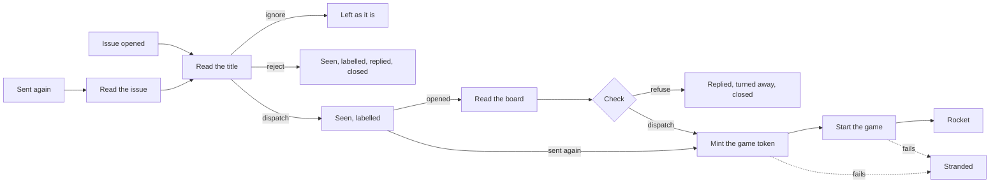

<!--
title: '🎲 MOVE INTAKE & MOVE SWEEP'
description: 'How the two workflows at the door run, step by step: when each starts, what every step does and with which token, what the scripts and the steps hand each other, and which failures strand a move. Read it before changing intake.yml, sweep.yml or a script either one runs.'
type: guide
-->

# 🎲 MOVE INTAKE & MOVE SWEEP

**How the two workflows at the door run, step by step, and what each step hands on.**

_Every step named, with its condition and its token._

---

## 💡 What This Covers

[The intake's README](../../src/intake/README.md) says what 🎲 Move Intake decides
for each kind of issue, and what ⏳ Move Sweep does with a move left waiting.
[GitHub App](../operations/GitHub-App.md) says what each token may do. This
page is the layer between them: the steps of
[`intake.yml`](../../.github/workflows/intake.yml) and
[`sweep.yml`](../../.github/workflows/sweep.yml) in the order they run, the
condition each one runs on, what the scripts and the steps hand each other, and
which failures leave a move `stranded`.

Read it before changing either workflow or a script it runs. For a move that
went wrong, [Troubleshooting A Move](../operations/Troubleshooting-Moves.md)
starts from what its issue shows.

---

## 🚀 When The Intake Runs

- **Triggers.** `issues: opened`, once for each new issue, and
  `workflow_dispatch` with an `issue` number, for an issue sent again by
  ⏳ Move Sweep or by the owner.
- **Skipped** always in a template, and for an issue an app or a bot opened,
  which is how each game posts its notices here. The router checks a move sent
  again for the same, once its issue is read.
- **One at a time for each player.** The concurrency group is keyed by the
  player's account ID, or by the issue's number for an issue sent again, and
  no run is cancelled. A player's next issue waits for their last, GitHub keeps
  only the newest one waiting, and an issue it drops is left to the sweep.
  Players never wait on each other.
- **The job** is `🎲 Route The Move`: five minutes at most, with
  `contents: read` to check out the router, and `issues: write` to react to,
  label, reply on, close and lock the issue.
- **The code** is `src/intake/` alone, checked out without keeping credentials,
  from the branch the run is on. An opened issue always runs on the default
  branch.

---

## 🧭 The Steps Of A Run

Every step, in the order it runs. "The run's own" is this repository's
`GITHUB_TOKEN`, which reaches nothing else.

| Step                         | Runs when                                                | Token                   | Does                                                                                                                  | If it fails           |
| :--------------------------- | :------------------------------------------------------- | :---------------------- | :-------------------------------------------------------------------------------------------------------------------- | :-------------------- |
| 🛡️ Harden Runner             | Every run                                                | -                       | Hardens the runner and audits its network egress                                                                      | Strands it            |
| 📂 Checkout The Router       | Every run                                                | The run's own, not kept | Checks out `src/intake/` alone                                                                                        | Strands it            |
| 📥 Read The Issue            | An issue sent again                                      | The run's own           | Checks the number's shape, then saves the issue as it is now to `issue.json`                                          | The run stops, silent |
| 🧭 Read The Title            | Every run                                                | -                       | `route.py` decides `dispatch`, `reject` or `ignore`, and writes what the steps below post                             | Strands it            |
| 🔑 Mint The Arbiter Token    | `dispatch` or `reject`                                   | -                       | Mints the Official Arbiter's token for the 👀 alone: Issues write on this repository                                  | A warning, and no 👀  |
| 👀 Mark It Seen              | The Arbiter's token was minted                           | The Arbiter's           | Reacts 👀                                                                                                             | A warning             |
| 🏷️ Label The Issue           | `dispatch` or `reject`                                   | The run's own           | Makes each label in `labels.json` that is missing, then adds them all                                                 | A warning             |
| 👀 Read The Board            | `dispatch`, for an opened issue                          | The run's own           | Saves the game's state to `game.json`, and the player's issues here in the last hour, any game, to `recent`           | A warning             |
| ⚖️ Check The Move            | `dispatch`, for an opened issue                          | -                       | `check.py` gives `verdict=refuse`, with a reply, or `verdict=dispatch`                                                | Strands it            |
| 🔑 Mint The Game Token       | `dispatch`, and not refused                              | -                       | Mints the game token, from the dispatch pair or else the Arbiter's: Actions write on the one repository the row names | Strands it            |
| 🔓 Unlock It For The Ruling  | A locked issue sent again, once the game token is minted | The run's own           | Unlocks the issue for the game's reply                                                                                | A warning             |
| 🎯 Start The Game            | `dispatch`, and not refused                              | The game token          | Posts `dispatch.json` to the game's workflow dispatch                                                                 | Strands it            |
| 🚀 Mark It Sent              | The game was started                                     | The run's own           | Reacts 🚀, and takes off `stranded` and `overdue`                                                                     | A warning             |
| ⛔ Turn The Move Away        | `refuse`                                                 | The run's own           | Posts `reply.md`, labels the issue `turned away`, closes it as not planned and locks it                               | The run fails         |
| 👋 Turn It Away              | `reject`                                                 | The run's own           | Posts `reply.md`, closes the issue as not planned and locks it                                                        | The run fails         |
| 🧯 Say It Did Not Go Through | A step failed before the game was started, as below      | The run's own           | Strands the issue                                                                                                     | The run fails         |

`ignore` runs nothing after 🧭 Read The Title: the owner's own issue gets no
👀, no label and no reply. A board the run could not read leaves the check to
judge without it, and an hour it could not count limits nobody.

### 🧯 What Strands A Move

🧯 Say It Did Not Go Through runs when a step before it failed and 🎯 Start The
Game did not succeed, unless the router decided `reject` or `ignore` or the
check refused. Then it:

1. finds the open outage notice, the open issue labelled `arbiter-outage`, or
   else opens one: `🧯 The Arbiter is down`, @mentioning the owner, and
   locked;
2. labels the issue `stranded`, making the label the first time it is needed;
3. posts the stranded reply, linking the notice, unless the issue was sent
   again already carrying `stranded`, so a player is told once;
4. locks the issue, with the API's own lock, which leaves a locked issue as it
   is.

For an opened issue it runs even when the router never got to decide, so an
issue opened while `routes.json` can't be read is stranded too, a move or not,
and the log of 🧭 Read The Title says what is wrong with the table, naming the
row when the fault is in one. For an issue sent again it runs
only once the router has named the issue: a run whose issue couldn't be read
has nothing to say it on.

A turn-away step that fails, ⛔ or 👋, fails the run without stranding the
issue. 🚨 CI Failure Alerts doesn't watch 🎲 Move Intake, so such a run shows
only in the Actions tab.

---

## 📦 What The Steps Hand Each Other

The title reaches `route.py` through the `TITLE` variable, or through
`issue.json` for an issue sent again, and nowhere else. No `run:` holds a
`${{ }}` expression, and no script prints a title. Everything else crosses as
step outputs and files.

The outputs:

| Output                              | Holds                                                                       | Written                                                    |
| :---------------------------------- | :-------------------------------------------------------------------------- | :--------------------------------------------------------- |
| `action`                            | `dispatch`, `reject` or `ignore`                                            | By 🧭 Read The Title, every time it decides                |
| `issue`, `player`, `player_id`      | The issue's number, and the login and account ID of whoever opened it       | The same, but for an issue sent again that it leaves alone |
| `game`, `owner`, `repo`, `workflow` | The move's game, and the repository and workflow its row in the table names | For `dispatch`                                             |
| `again`, `stranded`, `locked`       | `true`; whether the issue carried `stranded`; whether it was locked         | For an issue sent again                                    |
| `verdict`                           | `refuse` or `dispatch`                                                      | By ⚖️ Check The Move                                       |

The files, all in `$RUNNER_TEMP`:

| File            | Written by                                       | Read by                                          | Holds                                                                                             |
| :-------------- | :----------------------------------------------- | :----------------------------------------------- | :------------------------------------------------------------------------------------------------ |
| `issue.json`    | 📥 Read The Issue                                | `route.py`                                       | The issue sent again, as the API gives it now                                                     |
| `dispatch.json` | `route.py`                                       | 👀 Read The Board, `check.py`, 🎯 Start The Game | The dispatch's body: the row's `ref`, and the `inputs` a game receives                            |
| `labels.json`   | `route.py`                                       | 🏷️ Label The Issue                               | Each label's name, and the colour and description it is made with                                 |
| `reply.md`      | `route.py` for `reject`, `check.py` for `refuse` | 👋 Turn It Away, ⛔ Turn The Move Away           | The reply: fixed text, with no title in it                                                        |
| `game.json`     | 👀 Read The Board                                | `check.py`                                       | The game's state; `null` when GitHub answers 404, as before a first game; absent when unread      |
| `recent`        | 👀 Read The Board                                | `check.py`                                       | How many issues the player opened here in the last hour, whatever the game; absent when uncounted |
| `failed.md`     | 🧯 Say It Did Not Go Through                     | The same step                                    | The stranded reply                                                                                |

What a game receives in `inputs`, and the state the check reads, are in
[Cross-Repository Contracts](../references/Cross-Repository-Contracts.md).

---

## 🔁 An Issue Sent Again

- **It starts by number.** ⏳ Move Sweep runs
  `gh workflow run intake.yml --repo tannergolden/play -f issue=<number>`, and
  the owner can run 🎲 Move Intake with the issue's number from the Actions
  tab.
- **It is read as it is now.** `route.py` takes the title and the author from
  `issue.json`, not from an event, and leaves alone, as `ignore`, an issue that
  is closed, a pull request, one an app or a bot opened, one that isn't the
  issue asked for, or one it couldn't read. The log says which.
- **A move skips the board and the check**, and goes straight to its game: only
  the game can tell a move already played from that very issue, and it answers
  one as played. A move gone stale since is turned away by the game, with the
  reason.
- **It is unlocked for the ruling.** A move was locked when it was stranded or
  marked overdue, so 🔓 unlocks it once the game token is minted, and the game
  locks it again as it rules. 🚀 Mark It Sent takes off `stranded` and
  `overdue`.
- **It strands again if it fails**, and its player isn't told a second time when
  it already carried `stranded`.

---

## ⏳ When The Sweep Runs

- **Triggers.** A schedule at 11 minutes past every hour, UTC, and
  `workflow_dispatch`. GitHub starts a scheduled run late when it is busy,
  sometimes by hours.
- **Skipped** always in a template, and for a dispatch on any branch but the
  default, whose intake is the one a move is sent again through.
- **One at a time.** One concurrency group, and no run cancelled: two sweeps at
  once could each send the same move again.
- **The job** is `⏳ Answer Every Issue Left Waiting`: five minutes at most,
  with `contents: read`, `issues: write` to mark, tell and lock a move and open
  the notice, and `actions: write` to start 🎲 Move Intake. Every call uses the
  run's own token.
- **The code** is `src/intake/`, checked out without keeping credentials.
  `sweep.py` imports `route.py` and loads the table through it, so a table that
  can't be read stops the sweep before it acts.

---

## 🔎 How The Sweep Reads An Open Issue

It reads every open issue here, every page of them, and the open outage notice
among them: the open issue labelled `arbiter-outage`, the lowest-numbered one
if there are more. Then it takes each issue, oldest first:

1. **It leaves an issue out** if it is a pull request; was opened by anything
   but a `User`, which is to say an app or a bot; is labelled `played`,
   `turned away` or `invalid`, answered for good; is labelled `arbiter-outage`
   or `arbiter-logbook`, the Arbiter's own; or is the owner's own and not a
   move, by its `move` label or by a title the router would send on.
2. **`stranded`** and **`overdue`** are waiting to be sent again, however
   recently they were touched.
3. **Anything else waits until nothing has happened on it for 15 minutes**,
   counted from both its opening and its last update. Then a 🚀 from
   `github-actions[bot]`, 🎲 Move Intake's own token, makes it a move sent on
   and still unruled, and no such 🚀 makes it an issue never answered. A 🚀
   from anyone else doesn't count, and one that can't be read leaves the issue
   for the next sweep.

---

## 🧹 What A Sweep Does, In Order

1. **It marks each move sent on and unruled.** It opens the outage notice if
   none is open, locked and @mentioning the owner once. It gives the issue
   `overdue`, making the label the first time. It tells the player, linking the
   notice, only if the issue is unlocked and was never labelled `overdue`
   before, which it reads from the issue's events: a locked issue has had its
   reply already, from the intake or the game. Then it locks the issue.
2. **Then it sends issues again**, each by starting 🎲 Move Intake with its
   number. With no notice open, that is every `stranded` and `overdue` move.
   With one open, the one it may just have opened included, it is only the
   oldest `stranded` move, to find out whether the outage is over. Every issue
   never answered goes either way. They go oldest first, ten at most, and the
   next sweep takes the rest.

It prints a line for each issue it marked or sent again and for a notice it
opened, never a title. With nothing to do it says `Nothing is waiting.`, or
`Nothing more to do while #<n> is open.` Each call that fails is a warning
naming the issue, and the sweep goes on to the rest; it then ends in failure,
as it does when the open issues or the table can't be read, and
🚨 CI Failure Alerts opens an issue for it.

---

## ⚙️ When A Change Takes Effect

- **There is nothing to deploy.** Both workflows run the scripts as they are in
  the commit they check out. An opened issue and a schedule always run on the
  default branch, `Development`, and the sweep sends issues again on it, so a
  change merged there answers the next issue and the next sweep.
- **The game's side moves separately.** The row's `ref` in `routes.json` names
  the branch the game's workflow runs on, and 👀 Read The Board reads the
  game's state at the same `ref`.
- **The tests guard the scripts.** 🚦 Checks runs the suites of
  `.github/scripts`, `intake` and `replays` on every pull request and every
  push to the default branch. The intake's are run as
  [its README](../../src/intake/README.md#-running-the-tests) shows.

---

## 🔗 See also

- [Move Intake](../../src/intake/README.md) - what each decision does, the labels, the four games and adding one
- [Troubleshooting A Move](../operations/Troubleshooting-Moves.md) - a move stranded, overdue or never answered, from what its issue shows
- [Labels & Replies](../references/Labels-&-Replies.md) - every label and reply these steps post, and the code that writes each
- [Cross-Repository Contracts](../references/Cross-Repository-Contracts.md) - what a game receives, and the state the check reads
- [GitHub App](../operations/GitHub-App.md) - the Official Arbiter, and what each of its tokens may do

---

**Know what each step hands on before you change it.**

[↑ Back to Top](#top)

 

Built with ❤️ by the Engineering Team. Proprietary; all rights reserved under [LICENSE](../../LICENSE).

